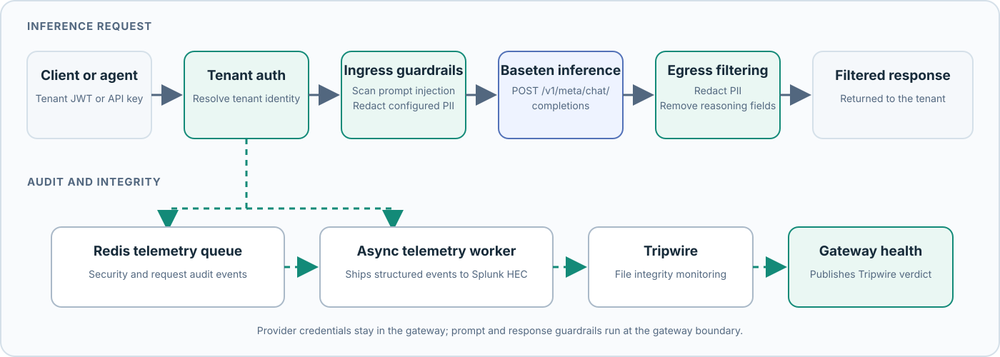

# AgentShield

AgentShield is a multi tenant AI gateway and agent platform. For the Meta Global AI Developer Hackathon, it routes requests to a Meta model hosted by Baseten and applies tenant authentication, ingress guardrails, output filtering, and asynchronous audit telemetry.

## Meta model request path



## Hackathon integration

- **Baseten routing:** `POST /v1/meta/chat/completions` proxies OpenAI compatible requests to the configured Baseten endpoint. The default model is `meta-models/muse-spark-open`.
- **YAML configuration:** `agent_shield_config.yaml` sets the provider, model, timeout, maximum output tokens, ingress guardrails, and reasoning sanitization.
- **Ingress protections:** configurable prompt injection detection blocks suspicious user prompts. Configured PII patterns are redacted before requests reach the provider.
- **Egress protections:** configured PII is redacted from model output, and `reasoning` and `reasoning_content` are removed from completion messages and deltas before the response is returned.
- **Tenant access:** the route accepts a verified tenant bearer token or an active tenant API key in `X-Tenant-API-Key`. Provider credentials stay in the gateway.
- **Audit and operations:** security and request events enter the asynchronous telemetry pipeline for Splunk HEC. Tripwire monitors configured files and publishes its verdict to the gateway health surface.

## Architecture

The stack includes an Angular portal, a Python FastAPI gateway, Java gateway and MCP services, Redis, Splunk, and Tripwire. The Python gateway handles tenant authentication, rate limits, billing and usage surfaces, key management, model proxying, and telemetry. The Java services provide a separate edge gateway and MCP server.

For the Meta route, the request path is:

1. Authenticate the tenant and resolve its tenant ID.
2. Scan user messages for prompt injection and reject detected attacks before proxying.
3. Redact configured PII and enforce the configured `max_tokens` limit.
4. Send the request to the configured model provider with the gateway's Baseten credential.
5. Redact configured PII from the response and remove internal reasoning fields.
6. Return the filtered response and queue content safe audit events for asynchronous shipping.

## Configuration

Copy the template and set the credentials you need:

```bash
cp .env.example .env
```

Set `BASETEN_API_KEY` in `.env`. The provider URL defaults to the value in `agent_shield_config.yaml`; `META_API_BASE_URL` can override it. Do not commit `.env` or share provider credentials.

Create a tenant API key in the Angular portal if you do not already have its full secret. The portal shows the secret only once. Save it in `.env` as `AGENTSHIELD_API_KEY` for local client commands. This is a client-side convenience variable; the gateway does not use it as its Baseten credential.

## Start the stack

To start the full local stack, configure the required Splunk values in `.env`, then run:

```bash
docker compose up -d --build
```

To rebuild only the Python gateway and its required Redis dependency:

```bash
docker compose up -d --build gateway-python
```

Useful endpoints:

| Service | Address |
| --- | --- |
| Angular portal | `http://localhost:4200` |
| Python gateway | `http://localhost:8000` |
| Java gateway | `http://localhost:8080` |
| MCP server | `http://localhost:8081` |
| Splunk web | `http://localhost:8001` |
| Splunk HEC | `https://localhost:8088` |

## Send a Meta inference request

Use a tenant key created in the portal. The literal `key_alpha_123` is not a provisioned key and will be rejected. In Bash or Zsh, load your local `.env` and send the key in the documented header:

```bash
set -a
. ./.env
set +a

curl --fail-with-body -X POST http://localhost:8000/v1/meta/chat/completions \
  -H "Content-Type: application/json" \
  -H "X-Tenant-API-Key: $AGENTSHIELD_API_KEY" \
  -d '{
    "model": "meta-models/muse-spark-open",
    "messages": [
      {"role": "user", "content": "Write a short Python function to calculate factorial and explain it."}
    ]
  }'
```

The route returns the upstream completion inside `model_output`, along with the resolved `tenant_id` and request status. A valid tenant key and configured Baseten credential are required.

## Tests

The focused Meta router suite is `gateway/tests/test_meta_router.py`. It covers successful proxying, tenant authorization, prompt injection blocking, input and output PII redaction, token limits, upstream failures and timeouts, telemetry event queueing, and reasoning sanitization. The upstream HTTP boundary is mocked, so these tests do not make a live Baseten request or prove Splunk has indexed an event.

The production gateway image does not include pytest or development requirements. Run the focused suite in a disposable Compose container with the workspace mounted:

```bash
docker compose run --rm --no-deps \
  -v "$PWD:/app" -w /app \
  --entrypoint /bin/sh gateway-python \
  -c 'python -m pip install --quiet -r requirements-dev.txt && python -m pytest -q gateway/tests/test_meta_router.py'
```

The current focused suite has 13 passing tests.

## Tripwire operations

Tripwire checks monitored files and reports both metadata and content differences. Docker Desktop file sharing can cause metadata drift, but review each report before changing the approved baseline. A baseline approval accepts the current monitored tree, including content changes.

Inspect the newest report:

```bash
docker compose exec tripwire sh -lc 'report=$(ls -t /var/lib/tripwire/report | head -n 1); twprint -m r -r "/var/lib/tripwire/report/$report"'
```

After reviewing and confirming the changes are authorized, approve the baseline:

```bash
docker compose exec tripwire /approve.sh --yes
```

Check the service health surface with a valid tenant token:

```bash
curl http://localhost:8000/v1/health/services \
  -H "X-Tenant-API-Key: $AGENTSHIELD_API_KEY"
```

## Security notes

- Keep `.env`, tenant API keys, and provider credentials out of source control and logs.
- Tenant API key secrets are returned only when created. Store them securely; the portal retains only masked key details for later display.
- A tenant API key belongs in `X-Tenant-API-Key`. `BASETEN_API_KEY` is a separate server-side provider credential.
- Inspect Tripwire reports before baseline approval. Approval is a security decision, not an automatic cleanup step.
- Model output is untrusted input. The Meta route removes known reasoning fields and redacts the configured PII patterns, but callers should continue to handle model output safely.

## License

License selection is pending.
